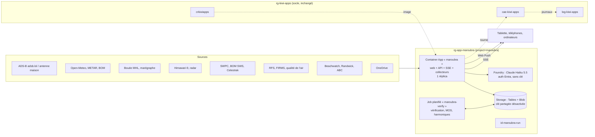

# Maroubra : plan du projet (v2)

> An ambient window on Maroubra: the sky, the sea, the beach, the weather and the night, read like an expert would, and right more often than any app on your phone.

Site en anglais, documentation en français. Hébergé sur le socle kiwi-apps : `https://maroubra.apps.akakiwi.com` (nom à confirmer).

Point de départ : les maquettes Claude Design ([canvas « Écran d'accueil Maroubra »](https://claude.ai/artifact/45BCE2BgPjavgj64SqYdp4)). La **direction B « Bord de mer »** est retenue pour le jour (Manrope, `#EEF3F5`, `#0E2A3B`, `#0B6E99`, `#D9481F`). La **direction A « Nuit »** devient le thème de nuit.

Ce qui change par rapport à la v1 :

- Le plan est construit avec le skill `/be-ambitious` : on vise mieux, pas plus gros.
- Retirés : trajets, agenda, tâches, trafic (trop personnels, ou pas demandés).
- Le site est pour **la famille**, en **anglais**, et **s'adapte** à l'ordinateur, à la tablette et au téléphone.
- Les actualités sont **locales** (Randwick, Maroubra), en anglais.
- Les photos viennent d'un dossier OneDrive.

---

## Partie A : l'ambition

### A.1 Le but derrière le but

Un écran d'accueil n'est qu'un moyen. Le vrai but est que **la famille ne rate plus les moments que Maroubra offre** : la baignade parfaite, le lever de soleil incendiaire sur la mer, la lune qui se lève sur l'océan, l'ISS qui passe à 19 h 42, l'A380 qui arrive, la fumée qui approche. Et que la famille puisse **faire confiance** à ce que l'écran annonce, parce qu'il a prouvé qu'il a raison.

### A.2 Les types d'ambition retenus

| Type | Retenu ? | Pourquoi |
|---|---|---|
| **Altitude** | Oui | L'écran sert une décision (« on y va ? », « on se lève ? », « on sort regarder ? »). On peut viser cette décision, pas l'affichage. |
| **Depth** | Oui | C'est là que le projet devient exceptionnel : partir des données brutes (bouée, marégraphe, radar, satellite, éphémérides, signaux ADS-B) et **vérifier chaque prévision contre la réalité**. |
| **Range** | Oui | Le ciel, la mer et la plage relèvent de métiers précis (prévisionniste, océanographe, sauveteur, astronome, photographe, contrôleur aérien). Leurs méthodes donnent les fonctionnalités. |
| Speed | Non | Le skill l'écarte toujours. |

Règle appliquée partout : **mieux, pas plus gros**. Aucune vue n'est ajoutée sans données réelles pour la nourrir et un juge extérieur pour la vérifier. C'est pour ça que la bioluminescence, les baleines et les requins ne sont **pas** des vues : je n'ai trouvé ni flux public ni méthode de prévision vérifiable (voir A.6).

### A.3 Altitude : l'échelle à trois barreaux

1. **Comprendre, pas afficher.** Chaque donnée est traduite en sens local. Pas « Wind NE 18 km/h », mais « Onshore breeze, choppy surf, bluebottles likely ». Pas « Cloud 40 % », mais « Broken high cloud east: sunrise could be spectacular ».
2. **Arriver aux décisions.** L'écran répond à « qu'est-ce qui vaut le coup dans les prochaines 24 h ? » par des **moments** datés, avec un créneau et une confiance : « Best swim 10:00 to 13:00 (high confidence) », « Moonrise over the sea 18:52 », « ISS visible 19:42, NW to SE, 5 min ». Chaque membre de la famille choisit les moments qu'il veut recevoir sur son téléphone.
3. **Remplacer le rituel.** Aujourd'hui, savoir tout ça demande une dizaine d'apps : BOM, Willyweather, Beachsafe, Surfline, Flightradar24, Heavens-Above, SpaceWeatherLive, Fires Near Me, Beachwatch. Le but est une **source unique, plus juste localement que chacune d'elles**, et qui le **prouve** : un carnet de vérification public (« Track record ») compare chaque prévision à l'observation et à la prévision brute du modèle. L'écran apprend ses propres biais locaux et les corrige.

**Mise en place nécessaire pour le barreau 3 :** archiver chaque prévision émise et chaque observation dès le premier jour (on ne peut pas vérifier rétroactivement), plus un job quotidien de vérification et de recalibrage.

**Juge du barreau 3 :** les observations (marégraphe, bouée, METAR de l'aéroport, radar, traces ADS-B, capteur de qualité de l'air), jamais moi ni la famille. Un plafond réaliste existe, donc on reste à ce barreau.

### A.4 Depth : travailler comme les meilleurs du domaine

**(1) Ce qu'un professionnel ferait ici, sans qu'on le demande**

- Un prévisionniste ne se contente pas de la sortie brute d'un modèle global : il la **corrige statistiquement contre les observations locales** (MOS, *Model Output Statistics*), et publie ses scores.
- Un océanographe ne prend pas les heures de marée d'une API : il **dérive les constantes harmoniques** d'années de mesures du marégraphe, puis les vérifie.
- Un spécialiste du radar fait une **prévision immédiate de la pluie** (*nowcast*) par extrapolation du mouvement des échos, pas une icône « pluie possible ».
- Un astronome calcule les éphémérides et les passages de satellites **localement**, depuis les éléments orbitaux, et les contrôle contre une référence.
- Un spotter connaît le **mode de pistes** de l'aéroport et sait quels flux survolent quel quartier. Il ne se contente pas d'une liste d'avions.

**(2) La matière la plus brute, au lieu de ce qui est déjà digéré**

| Domaine | Digéré (à éviter comme seule source) | Brut (à privilégier) |
|---|---|---|
| Météo | Icônes d'une app | Sorties de modèle par niveau (Open-Meteo, dont le modèle BOM ACCESS-G), **METAR de l'aéroport YSSY**, observations BOM |
| Pluie | « 40 % de pluie » | Images radar successives |
| Nuages, ciel | « Partiellement nuageux » | **Images satellite Himawari-9** (bucket public `noaa-himawari9` sur AWS, vérifié accessible depuis ce conteneur) |
| Mer | Hauteur de vague d'une app | **Bouée Waverider de Sydney** (Manly Hydraulics Laboratory : hauteur, période, direction, température de l'eau), modèles de vagues Open-Meteo Marine |
| Marée | Heures de pleine et basse mer | **Séries horaires du marégraphe** (Fort Denison ou Port Botany), analyse harmonique |
| Avions | Flightradar24 | **Messages ADS-B bruts** : agrégateur adsb.lol, puis à terme **notre propre antenne** |
| Ciel de nuit | Une app d'astronomie | Éphémérides calculées (astronomy-engine), éléments orbitaux TLE (Celestrak), indice Kp et modèle OVATION (NOAA SWPC), alertes aurores BOM |
| Feux | Une carte grand public | Flux GeoJSON NSW RFS, points chauds satellite NASA FIRMS, capteur PM2.5 de Randwick |

**(3) Les méthodes et outils**

- **MOS** : régression par échéance entre prévisions archivées et METAR YSSY, réentraînée chaque nuit.
- **Analyse harmonique** des marées (méthode UTide) sur l'historique du marégraphe.
- **Nowcast radar** par flux optique (méthode pySTEPS) sur les dernières images radar.
- **Propagation de la houle** de la bouée vers la plage, en tenant compte de l'orientation de Maroubra : la plage regarde vers l'est, donc un vent d'ouest est offshore.
- **Qualité du lever de soleil**, méthode des photographes : couverture nuageuse basse, moyenne et haute échantillonnée **le long de l'azimut du soleil**, au large, à plusieurs distances. Des nuages moyens et hauts avec un horizon dégagé donnent les plus belles couleurs.
- **SGP4** (satellite.js) pour l'ISS, **astronomy-engine** pour la lune, les planètes et la nuit noire (soleil sous −18°).
- **Mode de pistes de Sydney** déduit des traces ADS-B et du vent METAR. Les **flux qui survolent Maroubra** sont appris sur l'historique ADS-B.
- **Scores de vérification standard** : erreur moyenne absolue (MAE), indice de succès critique (CSI) pour la pluie, score de Brier pour les probabilités.

**(4) Ce qui, hors de moi et de toi, prouvera que c'est juste**

Chaque prévision est confrontée à une observation indépendante et à une **référence brute** (le modèle non corrigé, ou la persistance). Le résultat s'affiche dans la page « Track record », visible par la famille.

**Objectifs durs** (on les traite comme raisonnables, et on publie les vrais chiffres même s'ils sont manqués) :

| Domaine | Objectif | Juge |
|---|---|---|
| Marée | Heure de pleine et basse mer à ±5 min, hauteur à ±10 cm, sur 30 jours | Marégraphe observé |
| Température, vent à 24 h | MAE réduite d'au moins 25 % par rapport au modèle brut | METAR YSSY |
| Pluie dans l'heure | CSI à 30 min meilleur que la persistance et que le modèle brut | Images radar suivantes |
| Houle à la côte | MAE de la hauteur significative inférieure à celle du modèle brut | Bouée de Sydney |
| Survol de la maison | 90 % des alertes « overhead in N min » confirmées à moins de 1,5 km | Traces ADS-B |
| ISS, lune, planètes | Heures de passage à ±10 s, positions à moins de 1′ d'arc | Heavens-Above, JPL Horizons |
| Lever de soleil | Corrélation de rang ≥ 0,6 entre score prévu et qualité réelle, sur une saison | Votes de la famille (« Worth it? ») + couverture nuageuse Himawari à l'heure du lever |
| Fumée | Alerte « smoke heading our way » confirmée par une hausse du PM2.5 | Station qualité de l'air de Randwick |
| Fraîcheur | Positions d'avions à moins de 3 s au p95 (avec antenne maison) | Horodatage des messages |
| Performance | Premier affichage en moins de 1 s sur la tablette, carte à 60 images/s | Lighthouse, trace de performance |
| Fiabilité | Disponibilité 99,5 %, une source en panne n'efface jamais l'écran | Sonde externe |

### A.5 Range : les métiers qu'on fait entrer

**Les verbes, à la place des noms.** Ce site n'est pas « un tableau de bord ». Il doit :

- **lire** le ciel et la mer comme un expert ;
- **prévenir** au bon moment, sans jamais déranger ;
- **rendre visible l'invisible** : avions, satellites, houle au large, fumée, mode de pistes ;
- **tenir en un regard**, lisible à 3 m par toute la famille, enfants compris ;
- **vivre dans une pièce** 24 h/24 sans l'éclairer la nuit.

**L'équipe**

| Métier | Ce qu'il fait vraiment ici | Méthode ou outil |
|---|---|---|
| Prévisionniste météo | Corrige le modèle pour Maroubra, publie ses scores, donne une confiance | MOS, prévisions d'ensemble Open-Meteo, scores MAE / Brier |
| Météorologue radar | Pluie dans les 60 prochaines minutes | Flux optique sur images radar (pySTEPS) |
| Océanographe côtier | Marée, houle à la plage, température de l'eau | Analyse harmonique, bouée MHL, Open-Meteo Marine |
| Chef de patrouille de sauveteurs | Juge le danger de la plage | Grille de risque Beachsafe (1 à 10), type de plage (barres et baïnes), statut officiel toujours prioritaire |
| Astronome amateur | Ce qu'on peut voir ce soir, et quand il fait vraiment noir | astronomy-engine, SGP4 + TLE Celestrak, calendrier des essaims de météores |
| Prévisionniste météo spatiale | Chance d'aurore australe à −34° de latitude | Kp, OVATION (NOAA SWPC), alertes et veilles BOM Space Weather |
| Photographe de paysage | Lever, coucher, lune sur la mer, heure dorée et heure bleue | Nuages le long de l'azimut, éphémérides, orientation de la plage |
| Contrôleur aérien et spotter | Qui va passer au-dessus, sur quelle piste, quel avion rare | Lecture des METAR, mode de pistes, traces ADS-B, base de types d'avions, couvre-feu de Sydney (23 h à 6 h) |
| Analyste du comportement des feux | Feux proches et trajectoire de la fumée | RFS, FIRMS, vent, capteur PM2.5 |
| Cartographe et designer de données | Une carte et un axe de temps uniques pour toutes les couches | Protomaps / MapLibre, curseur de temps de −24 h à +48 h |
| Designer de technologie calme | L'écran informe en périphérie et ne réclame pas l'attention | Budget de notifications (2 par jour et par personne au plus), thème Nuit atténué |
| Ingénieur fiabilité | Rien ne casse en silence | Objectifs de fraîcheur par source, sondes synthétiques |

### A.6 Ce que j'ai écarté, et pourquoi

| Idée | Raison |
|---|---|
| Alertes requins | Le réseau SharkSmart diffuse via son app et X ; je n'ai trouvé **aucune API publique** ([SharkSmart](https://www.sharksmart.nsw.gov.au/shark-activity)). On garde le statut de plage officiel, qui inclut les fermetures pour requin. |
| Baleines | Pas de flux officiel en temps réel ; seulement des journaux d'opérateurs de croisière. Au mieux, une mention de saison (mai à novembre). |
| Bioluminescence | Aucune méthode de prévision publiée, aucun seuil local : pas de juge possible. |
| Trajets, agenda, tâches, trafic | Retirés à ta demande. |

---

## Partie B : le produit

### B.1 Une seule app, trois formats, deux humeurs

- **Formats** : téléphone (puces + vues empilées, comme le prototype B mobile), tablette (bandeau + vue, comme le prototype B tablette), ordinateur (vue + panneau latéral « Next 24 h » toujours visible). Mise en page fluide, pas trois sites.
- **Mode ambiant** (tablette posée) contre **mode personnel** (téléphone en main). Le mode ambiant ajoute le maintien de l'écran allumé (Screen Wake Lock), le cadre photo et la protection contre le marquage. Il ne dépend pas de la taille d'écran. La tablette Android n'étant pas encore choisie, rien ne dépend du modèle.
- **Jour et Nuit** : bascule au crépuscule civil, calculée. La nuit, le thème A atténué, et option « red light » pour ne pas éblouir.

### B.2 Les vues

L'écran principal est construit autour d'**une carte et d'un axe de temps** partagés : avions, nuages Himawari, pluie, houle, soleil, lune, trajectoire de l'ISS, feux. On fait glisser le temps de −24 h à +48 h et tout bouge ensemble. Les vues ci-dessous sont des lectures expertes de cette même scène.

| Vue | Ce qu'elle montre | Ce qui la rend exceptionnelle |
|---|---|---|
| **Overhead** (vols) | Avions en direct, avion sélectionné, liste autour de la maison | Mode de pistes en cours, **prédiction « overhead in N min »** vérifiée, avions rares, couvre-feu (« Curfew: next arrival 06:00 »), « planes today » |
| **Weather** | Actuel, heure par heure, 7 jours, vent, UV, humidité | Prévision **corrigée localement**, avec confiance, **pluie dans l'heure** par nowcast, image satellite réelle |
| **Beach** | Statut officiel, conditions, marée, qualité de l'eau, webcam si les droits le permettent | **Swim score** expliqué (marée, houle, vent, UV, qualité de l'eau, surveillance), meilleur créneau du jour, risque de baïnes et de physalies (vent d'est) |
| **Sea** | Houle mesurée à la bouée et prévue, période, direction, température de l'eau, marée | Propagation **bouée → plage**, état de la mer « glassy / choppy / messy », navires vers Port Botany (si la source est validée) |
| **Sky** (jour et nuit) | Soleil, lune, planètes, ISS, nuit noire, aurores | **Sunrise score** sur la mer, **moonrise over the sea**, fenêtre Voie lactée, passages ISS visibles, alerte aurore sur veille BOM |
| **Fire & Air** | Feux actifs proches, qualité de l'air | Trajectoire de la fumée selon le vent, confirmée par le PM2.5 |
| **Local news** | Actualités de Randwick et Maroubra, en anglais | Filtrage géographique et résumé par Claude, doublons regroupés |
| **Photos** | Diaporama du dossier OneDrive | Lieu et date (EXIF), démarrage automatique en cas d'inactivité ou la nuit |
| **Track record** | Scores de vérification de chaque prévision | La preuve publique que l'écran a raison, et où il se trompe |

### B.3 Les moments

Des règles déclaratives sur l'état normalisé produisent des moments (titre en anglais, créneau, confiance, expiration). Exemples :

- « Best swim today 10:00 to 13:00 »
- « Sunrise worth getting up for (score 8/10) »
- « Moonrise over the sea 18:52 »
- « ISS visible 19:42 »
- « Rain in 20 min »
- « Aurora watch issued »
- « Smoke heading our way »
- « A380 overhead in 3 min »

Ils s'affichent dans le panneau « Next 24 h » et partent en notification Web Push vers ceux qui les ont choisis, dans la limite du budget de notifications.

Le **brief** est une phrase en tête d'écran, rédigée par Claude à partir de l'état réel et des moments, jamais inventée.

### B.4 Actualités locales (en anglais)

Sources candidates, à valider en phase 0 :

- Flux RSS de Randwick City Council : il existe, avec un filtre par quartier dont Maroubra ([Randwick, latest news](https://www.randwick.nsw.gov.au/about-us/news/latest-news)).
- ABC Sydney.
- Communiqués NSW Police filtrés sur le secteur Eastern Beaches.
- Beachwatch et RFS pour les actualités environnementales.
- Je n'ai pas trouvé de flux pour le Southern Courier.

Claude classe chaque article (local ou non, sujet) et le résume. **Juge** : un échantillon de 100 articles étiquetés à la main, avec une précision visée d'au moins 90 %.

---

## Partie C : architecture sur le socle kiwi-apps

Toutes les règles du socle s'appliquent :

- Bicep, puis build et what-if, résumé en français, et OK de Samuel avant chaque déploiement.
- Tag `project=maroubra` partout. Rien dans `rg-kiwi-apps` hormis les rôles du projet sur l'ACR.
- Aucun secret sans accord explicite.
- Chaque choix Azure ci-dessous cite sa page Microsoft Learn.



| Choix | Décision | Source Learn |
|---|---|---|
| Hébergement | Une Container App `maroubra` dans `cae-kiwi-apps`, `minReplicas = maxReplicas = 1`. Un seul réplica, car les collecteurs tiennent l'état et ne doivent pas tourner en double. Le réplica n'est jamais inactif (sondage ADS-B toutes les 5 s), donc facturé au tarif actif après la franchise mensuelle de 180 000 vCPU-s et 360 000 Gio-s. | [Billing in Azure Container Apps](https://learn.microsoft.com/azure/container-apps/billing#consumption-plan), [Scaling](https://learn.microsoft.com/azure/container-apps/scale-app#scale-definition) |
| Temps réel | Server-Sent Events. L'ingress coupe toute requête HTTP à **240 s**, donc le serveur ferme proprement le flux toutes les 200 s environ, et le client se reconnecte avec `Last-Event-ID` (reprise sans perte). Un commentaire de maintien est envoyé toutes les 15 s. | [Ingress in Azure Container Apps](https://learn.microsoft.com/azure/container-apps/ingress-overview#protocol-types) |
| Vérification, MOS, harmoniques | Un job Container Apps planifié (cron en UTC), facturé seulement pendant l'exécution. | [Jobs in Azure Container Apps](https://learn.microsoft.com/azure/container-apps/jobs#job-trigger-types) |
| Historique et archive | Compte de stockage : Tables pour les séries et l'archive des prévisions, Blob pour PMTiles, vignettes Himawari et cache photos. `allowSharedKeyAccess: false`, accès par `id-maroubra-run` avec les rôles Storage Table Data Contributor et Storage Blob Data Contributor. | [Prevent Shared Key authorization](https://learn.microsoft.com/azure/storage/common/shared-key-authorization-prevent) |
| Connexion de la famille | Authentification intégrée Container Apps avec Microsoft Entra ID. La famille est invitée dans le tenant, avec « assignation requise » pour limiter l'accès. **Sans secret** : l'app registration fait confiance à une identité managée (credential fédéré). Ce schéma est documenté pour App Service et Static Web Apps. Container Apps partage le même système d'authentification, mais il **reste à confirmer en phase 0**. Google demanderait un secret client stocké dans l'app : écarté. | [Auth in Container Apps](https://learn.microsoft.com/azure/container-apps/authentication), [Use a managed identity instead of a secret](https://learn.microsoft.com/azure/app-service/configure-authentication-provider-aad#use-a-managed-identity-instead-of-a-secret), [Restrict to a set of users](https://learn.microsoft.com/entra/identity-platform/howto-restrict-your-app-to-a-set-of-users) |
| Claude | Claude Haiku 5.5 déployé dans Microsoft Foundry, appelé avec l'identité managée (Entra ID, sans clé). Prérequis : abonnement payant avec moyen de paiement, et région de facturation où Anthropic vend les modèles, **à vérifier pour l'Australie**. | [Deploy and use Claude models in Foundry](https://learn.microsoft.com/azure/foundry/foundry-models/how-to/use-foundry-models-claude), [Claude models in Foundry](https://learn.microsoft.com/azure/foundry/foundry-models/concepts/claude-models) |
| Photos OneDrive | **OneDrive professionnel** : permission applicative `Files.SelectedOperations.Selected`, limitée au seul dossier, obtenue par l'identité managée, sans secret. **OneDrive personnel** : seul l'accès délégué fonctionne, ce qui oblige à stocker un jeton de rafraîchissement (un secret, donc ton accord). | [Selected permissions in OneDrive and SharePoint](https://learn.microsoft.com/graph/permissions-selected-overview), [Permissions reference](https://learn.microsoft.com/graph/permissions-reference#all-permissions) |
| Journaux | Sortie console structurée, collectée par l'environnement dans `log-kiwi-apps`. Une page `/health` affiche la fraîcheur de chaque source. | [docs/socle.md du socle](https://github.com/Leumas09/platform/blob/main/docs/socle.md) |

**Pile logicielle**

- TypeScript strict, monorepo pnpm.
- Front : React + Vite, PWA, MapLibre GL et Protomaps (PMTiles dans Blob, stylé direction B / A).
- Serveur : Node 22 + Hono.
- Calculs : astronomy-engine et satellite.js (côté serveur et client).
- Job de vérification : Python (UTide, pySTEPS et statsmodels sont des outils Python éprouvés ; les réécrire en TypeScript n'apporterait rien).
- Tests : Vitest, Playwright pour les trois formats.

**Ordre de grandeur des coûts** (à confirmer avec la calculatrice de prix Azure, Learn ne publie pas les tarifs unitaires) :

- Container App 0,25 vCPU / 0,5 Gio active en continu : une quinzaine de dollars US par mois après la franchise.
- Job et stockage : quelques dollars.
- Claude Haiku pour le brief et les actualités : faible, à chiffrer en phase 0.

---

## Partie D : feuille de route

Chaque phase se termine par quelque chose d'utilisable par la famille.

### Phase 0 : fondations et banc d'essai
- Dépôt `Leumas09/app-maroubra` (convention du socle), Bicep, identités, OIDC, première image servie sur `maroubra.apps.akakiwi.com`.
- Authentification de la famille (y compris la confirmation du schéma sans secret).
- **Spike sources lancé depuis Azure** : un job qui appelle chaque source, enregistre statut, latence, conditions d'usage et un échantillon.
- **L'archive démarre dès cette phase** : prévisions et observations enregistrées toutes les heures, car la vérification aura besoin de semaines d'historique.
- ✅ La famille se connecte. L'archive tourne. Le rapport de sources dit ce qui est fiable.

### Phase 1 : l'écran vivant
- Bandeau et vues Weather, Beach, Sea en données réelles.
- Trois formats, thèmes Jour et Nuit.
- Actualités locales (RSS + filtre simple), mode photo.
- ✅ La tablette et les téléphones affichent Maroubra en direct.

### Phase 2 : la scène unifiée et Overhead
- Carte unique + curseur de temps, couches avions, nuages Himawari, pluie, houle.
- Vue Overhead complète, mode de pistes, couvre-feu.
- ✅ On voit le passé récent et les prochaines 48 h sur une seule carte.

### Phase 3 : Sky et la nuit
- Éphémérides, ISS, planètes, nuit noire, aurores.
- Sunrise score, moonrise over the sea.
- Thème Nuit atténué, cadre photo nocturne.
- ✅ Le soir, l'écran dit quoi regarder et quand.

### Phase 4 : l'intelligence vérifiée
- MOS, harmoniques de marée, nowcast pluie, propagation de houle, prédiction de survol.
- Moments, notifications Web Push, brief Claude, filtrage des actualités.
- **Page Track record.**
- ✅ Les objectifs durs de A.4 sont mesurés et publiés, atteints ou non.

### Phase 5 : aller plus loin là où les données le permettent
- **Antenne ADS-B maison** (Raspberry Pi + clé RTL-SDR) : des données vraiment locales, une latence de l'ordre de la seconde, et la clé d'API qu'adsb.lol prévoit de réserver à ceux qui alimentent son réseau.
- Fire & Air complet (FIRMS, trajectoire de fumée).
- Navires de Port Botany, si une source sans clé ou une clé acceptée existe.

---

## Partie E : accès nécessaires et décisions

### E.1 Ce qui est là, ce qui manque

| Besoin | État |
|---|---|
| Socle kiwi-apps et sa documentation | ✅ lu (`Leumas09/platform`) |
| Maquettes Claude Design | ✅ lues |
| Documentation Microsoft Learn | ✅ consultée et citée |
| **Appeler les sources depuis cette session** | ❌ le réseau de l'environnement cloud refuse adsb.lol, Open-Meteo, NOAA SWPC, RFS, Beachwatch, MHL, Celestrak, RainViewer, BOM (seul `noaa-himawari9.s3.amazonaws.com` passe). Le spike se fera depuis Azure (phase 0), ou bien tu ajoutes ces domaines aux domaines autorisés de l'environnement. |
| Session Azure (`az login` sur `ops@…`) | ❌ à faire par toi au moment du déploiement |
| Création du dépôt `app-maroubra` | ❌ ton accord (voir E.2) |
| Comptes de la famille invités dans le tenant | ❌ à faire par toi (connexions interactives) |
| Claude dans Foundry | ❌ disponibilité pour ton abonnement et ta région à vérifier |
| Historiques pour calibrer : traces ADS-B passées (archives publiques adsb.lol), séries du marégraphe (UHSLC ou MHL), archives METAR YSSY | ❌ à valider en phase 0 |

### E.2 Décisions à prendre

1. **Nom** : `maroubra.apps.akakiwi.com` et dépôt `app-maroubra` ? Le dépôt actuel `homeScreen` ne suit pas la convention `app-<nom>`. Je propose de le **renommer en `app-maroubra` avant** de créer le credential fédéré : le sujet OIDC contient le nom et l'ID du dépôt, un renommage après coup le casserait.
2. **OneDrive** : personnel ou professionnel ? Professionnel : aucun secret. Personnel : un jeton de rafraîchissement à stocker, donc ton accord.
3. **Secrets acceptés ?** Trois fonctionnalités en demandent un :
   - Web Push : paire de clés VAPID, indispensable aux notifications.
   - NASA FIRMS : clé gratuite.
   - Navires AIS : clé aisstream.
   Sans ton accord, ces fonctionnalités attendent.
4. **Antenne ADS-B maison** (environ 100 AUD de matériel, une fenêtre avec vue dégagée) : oui, non, plus tard ?
5. **Famille** : combien de personnes, et des enfants (pour le ton du brief et des notifications) ?

### E.3 Le prompt réécrit

```
Construis « Maroubra », un écran ambiant en anglais pour ma famille, hébergé sur le socle kiwi-apps
(maroubra.apps.akakiwi.com), qui s'adapte au téléphone, à la tablette et à l'ordinateur.

But : que la famille ne rate plus les moments que Maroubra offre (baignade, lever de soleil sur la mer,
lune, ISS, aurores, avions, fumée) et puisse faire confiance à ce que l'écran annonce.

Travaille comme un prévisionniste, un océanographe, un sauveteur, un astronome, un photographe et un
contrôleur aérien : pars des données brutes (METAR YSSY, bouée MHL, marégraphe, radar, Himawari-9,
ADS-B, TLE, Kp/OVATION, RFS, PM2.5), corrige les modèles localement (MOS, harmoniques, nowcast),
et archive chaque prévision et chaque observation dès le premier jour.

Respecte les règles du socle : Bicep, what-if et mon OK avant tout déploiement, aucun secret sans mon
accord, Microsoft Learn cité pour chaque choix Azure.

Juge : la page Track record compare chaque prévision à l'observation et au modèle brut. Réussite si,
sur 30 jours : marée à ±5 min et ±10 cm, MAE température et vent réduite de 25 % contre le modèle brut,
CSI pluie à 30 min meilleur que la persistance, 90 % des alertes de survol confirmées à 1,5 km,
ISS à ±10 s, premier affichage < 1 s sur la tablette, disponibilité 99,5 %.
Les vrais chiffres sont publiés, même s'ils manquent la cible.
```

### E.4 Prochaine étape

Voir la partie F : le banc et les premiers écrans sont faits. La suite (phase 0 Azure) demande toujours tes réponses à E.2 et ton OK sur un what-if.

---

## Partie F : avancement au 31 octobre 2026

Fait dans cette session, sans Azure et sans aucune clé, en partant des données brutes. Chaque résultat a un juge extérieur et une période jamais vue à l'apprentissage. Les objectifs manqués restent affichés.

### F.1 Résultats du banc (`bench/`)

| Contrôle | Objectif | Résultat | Juge | Verdict |
|---|---|---|---|---|
| Température à l'aéroport, échéances 6 à 48 h | −25 % d'erreur contre le modèle brut | **−34,3 %** (IC 95 % : 29,4 à 38,9) | Observations YSSY (NOAA ISD), février à août 2025 | Atteint |
| Vent à l'aéroport | −25 % | **−15,9 %** (IC 95 % : 12,6 à 19,1) | Idem | Manqué |
| Houle à la bouée de Sydney | Mieux que le modèle brut | Aucune correction ne fait mieux ; GFS-Wave brut (24 cm d'erreur) est sans biais | Bouée MHL, juillet 2025 à juin 2026 | Manqué, modèle brut gardé |
| Hauteurs des pleines et basses mers | ±10 cm | **3,0 cm** en moyenne, 90 % sous 5,5 cm | Capteurs IMOS ORS065, année 2025 | Atteint |
| Heures des pleines et basses mers | ±5 min | 14 min, **égal au bruit du juge seul** (14 min) | Idem | Non vérifiable avec ce capteur |
| Levers et couchers Soleil et Lune, 2027 | ±30 s | **2,1 s** au pire | Skyfield + JPL DE421 | Atteint |
| Planètes le soir, 2027 | 1′ | **0,23′** au pire | Skyfield + JPL DE421 | Atteint |
| Premier affichage (ordinateur, wifi) | < 1 s | **0,4 s**, performance 100 | Lighthouse | Atteint |
| Premier affichage (mobile, 4G lente simulée) | < 1 s | 1,2 s, performance 100, blocage 0 ms | Lighthouse | Manqué de peu |
| Accessibilité, jour et nuit | 0 défaut | 0 violation (axe), 100 (Lighthouse) | axe-core | Atteint |

Méthode météo : six variantes comparées à chaque échéance (modèle brut GFS, IFS brut, moyenne GFS et IFS, biais retiré, MOS linéaire, biais décroissant de la NOAA, correction apprise par gradient boosting). La meilleure est la correction apprise qui combine **GFS et IFS**, les 4 points de grille et la dernière observation connue à l'émission. Par transparence : la configuration de la température a été évaluée 3 fois sur la période test, et celle du vent 4 fois. Chaque choix de variables était fixé avant de regarder le résultat.

### F.2 Ce que le banc a appris (et qui change le plan)

- **Beaucoup de sources n'ont besoin d'aucune clé.** Elles sont sur AWS Open Data et lisibles depuis Azure : modèle GFS et vagues (`noaa-gfs-bdp-pds`), modèle européen IFS (`ecmwf-forecasts`), observations horaires de l'aéroport (`noaa-global-hourly-pds`), bouée de Sydney en quasi temps réel et mouillages IMOS (`aodn-cloud-optimised`), images Himawari-9 toutes les 10 min (`noaa-himawari9`). Elles remplacent avantageusement Open-Meteo pour la vérification, et le complètent pour l'affichage.
- **La marée se calcule sans API** : analyse harmonique de 20 ans de mesures du mouillage ORS065, à 7 km. WorldTides et toute autre clé sont inutiles. Reste à valider les heures contre un marégraphe à la minute (MHL ou BOM, Port Botany), depuis Azure.
- **Il ne faut pas corriger la houle.** Le modèle brut est sans biais, son erreur est d'ordre spatial (maille de 25 km contre bouée ponctuelle). Pour progresser, il faudra un modèle de vagues côtier plus fin, ou afficher la bouée elle-même pour l'état actuel.
- **Le vent est limité par la résolution des modèles globaux.** La prochaine piste sérieuse est un modèle régional (BOM ACCESS-C 1,5 km, via Open-Meteo depuis Azure) ajouté au mélange appris.
- **Le premier affichage dépend de la coquille statique et du Web Worker**, pas du framework. Le calcul du ciel tourne hors du fil principal, la feuille de style est intégrée.

### F.3 Ce qui tourne dans l'app (`apps/web`)

- Vue **Sky** : panorama face au nord (le Soleil de Maroubra passe au nord, la mer est à droite), trajectoires sur 24 h, Lune, nuit noire, planètes, levers de Lune sur la mer à 30 jours.
- Vue **Tide** : marée calculée localement, courbe sur 30 h, prochaines pleines et basses mers, avec la méthode et ses limites expliquées.
- Vue **Track record** : les tableaux de F.1, en anglais pour la famille.
- Thème Jour (direction B) ou Nuit (direction A) selon la vraie hauteur du Soleil, trois formats, panneau « Next 24 h » sur grand écran.
- Images Himawari-9 de Sydney : pipeline validé dans `bench/himawari_sydney.py`, pas encore à l'écran.

### F.4 Suite proposée, dans l'ordre

1. **Phase 0 Azure** (ton OK nécessaire) : dépôt `app-maroubra`, Bicep, déploiement de l'app actuelle, job quotidien qui régénère la table des marées et le Track record à partir des archives AWS.
2. **Bouée et marégraphe en direct** depuis Azure : état de la mer mesuré, et validation des heures de marée à la minute.
3. **Correction apprise en production** : archiver chaque prévision émise dès le jour 1, réentraîner chaque nuit, publier les scores glissants.
4. **ACCESS-C pour le vent**, puis image satellite et score de lever de soleil, jugés par la couverture nuageuse Himawari à l'heure du lever.

---

## Sources consultées

- Socle : [Leumas09/platform](https://github.com/Leumas09/platform) (`CLAUDE.md`, `docs/socle.md`, `docs/projet.md`)
- Bouées MHL : [data.gov.au, MHL Waverider buoys](https://data.gov.au/data/dataset/000cb6d7-dea9-4e3a-869e-08f99e5f3434), [AODN wave buoys realtime](https://registry.opendata.aws/aodn_wave_buoy_realtime_nonqc/)
- Beachwatch : [data.nsw.gov.au, Beachwatch](https://data.nsw.gov.au/data/dataset/beachwatch), [Sydney Ocean Beaches Pollution Forecast](https://data.nsw.gov.au/data/dataset/beachwatch/resource/9dae1501-b9dd-4bcb-bfb5-1b2568e454fa), [paquet beachwatch](https://pypi.org/project/beachwatch)
- Beachsafe : [SLSA, Beachsafe app](https://www.manula.com/manuals/slsa/psar/35/en/topic/beachsafe-app) (pas d'API publique trouvée)
- Aurores : [BOM Space Weather, Aurora](https://www.sws.bom.gov.au/Aurora), [BOM SWS API](https://www.sws.bom.gov.au/Geophysical/5/2/1)
- Himawari-9 : [AWS Open Data, NOAA Himawari](https://registry.opendata.aws/noaa-himawari)
- ADS-B : [API adsb.lol](https://identichosting.duckdns.org/adsblol/api) (documentation interactive sur api.adsb.lol/docs)
- Feux : [NSW RFS Current Incidents Feed](https://data.nsw.gov.au/data/dataset/ecac2f75-39ea-450b-9542-8a69dce41e1f)
- Requins : [SharkSmart NSW](https://www.sharksmart.nsw.gov.au/shark-activity)
- Actualités : [Randwick City Council, latest news](https://www.randwick.nsw.gov.au/about-us/news/latest-news)
- Baleines : [Captain Cook Cruises, sightings](https://www.captaincook.com.au/sydney-harbour-cruises/explore/whale-watching/sightings) (journal d'opérateur, pas un flux officiel)
- Bioluminescence : [Deep Sea News](https://deepseanews.com/2012/11/whats-green-and-gold-and-red-all-over/) (pas de méthode de prévision)
