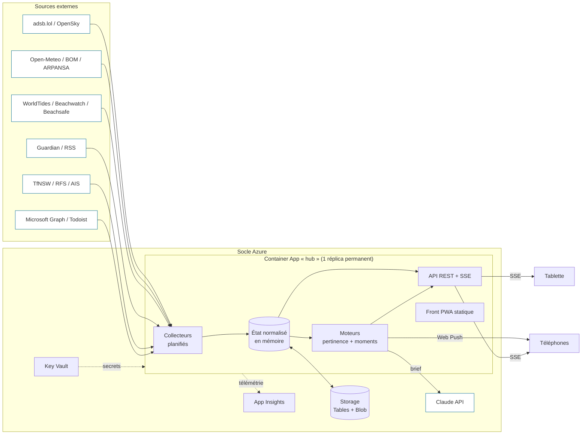

# Maroubra Home : plan du projet

> Un écran d'accueil vivant pour la tablette du bureau et les téléphones : ce qui se passe **au-dessus**, **devant** et **autour** de chez moi, en un coup d'œil.

Point de départ : les maquettes Claude Design ([canvas « Écran d'accueil Maroubra »](https://claude.ai/artifact/45BCE2BgPjavgj64SqYdp4)). La **direction B « Bord de mer »** est retenue (Manrope, fond `#EEF3F5`, encre `#0E2A3B`, accent `#0B6E99`, alerte `#D9481F`, cartes blanches très arrondies). Ses prototypes tablette (1280×800) et mobile (390×844) servent de référence pour la mise en page.

---

## 1. La vision

Les maquettes montrent un bon tableau de bord. Je propose d'aller plus loin : un **écran ambiant qui comprend le contexte**. Il ne se contente pas d'afficher des widgets, il met en avant ce qui compte maintenant.

Trois principes :

1. **Local d'abord.** Tout est centré sur Maroubra : les avions qui passent au-dessus de la maison, la plage au bout de la rue, la marée, les bus de Maroubra Junction. Rien de générique.
2. **L'écran choisit pour moi.** Un moteur de pertinence réordonne et met en valeur les cartes (le matin : trajets et agenda ; le week-end à 14 h : plage ; un A380 en approche : la carte Vols s'allume). Le soir, le thème bascule seul en mode **Nuit** (la direction A, recyclée), et la nuit l'écran devient un cadre photo.
3. **Il me prévient quand ça vaut le coup.** Des « moments » poussés sur le téléphone : « Baignade idéale entre 10 h et 13 h », « Pluie dans 20 min », « A380 de Qantas au-dessus dans 2 min », « Plage fermée : requin aperçu ».

---

## 2. Fonctionnalités

### 2.1 Le bandeau vivant (toujours visible)
L'horloge, plus une carte par domaine, cliquable pour ouvrir la vue détaillée (comme dans les maquettes). Chaque carte affiche **depuis quand ses données datent**, et passe en état dégradé si la source ne répond plus.

### 2.2 Vues détaillées (issues des maquettes)

| Vue | Contenu | Au-delà des maquettes |
|---|---|---|
| **Vols** | Carte vectorielle, avions en temps réel, avion sélectionné (route, altitude, vitesse, distance, ETA), liste autour de moi | Photo de l'appareil, trace des 10 dernières minutes, piste en service, **alerte « avion rare »** (A380, 747, militaire, hélico de secours), compteur « avions du jour » |
| **Météo** | Actuel, courbes heure par heure (temp. / pluie / vent), vent, humidité, UV, soleil, 7 jours | **Radar de pluie animé**, prévision de pluie à la minute, qualité de l'air (station Randwick), UV mesuré en direct |
| **Plage** | Statut ouvert/fermé et motif, webcam, eau, houle, vent, UV, courbe de marée | **Indice « Baignade »** de 0 à 10 calculé (marée, houle, vent, UV, qualité de l'eau, surveillance), meilleur créneau du jour, conditions de surf (période et direction de la houle) |
| **News** | Breaking, deux colonnes International / Sydney & NSW, lecteur d'article | **Résumé et traduction en français par Claude**, regroupement des dépêches en doublon |
| **Mode photo** | Diaporama plein écran, heure, lieu et date de la photo | Effet Ken Burns, démarrage automatique en cas d'inactivité ou la nuit, sortie au toucher |

### 2.3 Nouvelles vues proposées

| Vue | Contenu |
|---|---|
| **Trajets** | Prochains départs en temps réel aux arrêts proches (bus Maroubra Junction, tram L3 Kingsford), perturbations, temps de trajet vers 2 ou 3 lieux favoris |
| **Ma journée** | Prochain rendez-vous (Microsoft 365), tâches du jour (Todoist), anniversaires |
| **Mer** | Navires en approche de Port Botany (AIS), paquebots du jour, houle au large |
| **Ciel** | Phase de lune, passages de l'ISS visibles depuis Maroubra, coucher de soleil « qualité photo », étoiles et planètes visibles ce soir |
| **Alertes** | Feux de brousse et brûlages dirigés (fumée), trafic routier, alertes BOM |

### 2.4 L'intelligence

- **Moteur de pertinence** : chaque carte reçoit un score selon l'heure, le jour, la météo et les événements. Le bandeau se réordonne et la carte la plus pertinente est mise en avant. Règles simples et lisibles d'abord (pas de ML).
- **Moteur de moments** : des règles déclaratives sur l'état normalisé produisent des moments (titre, gravité, expiration). Ils s'affichent dans un fil et sont envoyés en **Web Push** sur les téléphones (PWA installée ; iOS le gère depuis la 16.4). Heures de silence configurables.
- **Le brief** : une phrase en tête d'écran, régénérée toutes les 30 min par Claude à partir de l'état réel. Exemple : « Grand bleu, marée basse à 13 h : le meilleur créneau baignade est 11 h-13 h. Le 787 d'Air NZ arrive dans 5 min. » Modèle léger (`claude-haiku-5-5`), quelques centimes par mois.

### 2.5 Pensé pour une tablette posée sur un bureau
- Plein écran, PWA installable, **Screen Wake Lock** pour garder l'écran allumé.
- Thème **Jour** (direction B) ou **Nuit** (direction A) selon le lever et le coucher du soleil, luminosité réduite la nuit.
- Protection contre le marquage de l'écran (léger décalage des pixels toutes les quelques minutes, photos la nuit).
- Résilience : le service worker garde le dernier état. Une coupure réseau affiche des données datées, jamais un écran vide.
- Cibles tactiles de 44 px minimum, lisible à 2 m (gros chiffres, contrastes AA).
- Mobile : même application, mise en page en puces et vues empilées (comme le prototype mobile).

---

## 3. Sources de données

Tout ce qui est marqué **à valider** sera testé lors du spike de la phase 0 (disponibilité, conditions d'utilisation, quotas).

| Domaine | Source principale | Plan B | Rafraîchissement |
|---|---|---|---|
| Avions (positions) | **adsb.lol** API (gratuite, sans clé) | OpenSky Network (compte gratuit) ; à terme **mon propre récepteur ADS-B** | 5 s |
| Avions (route, type, photo) | adsbdb.com, planespotters.net | n/a | à la demande, avec cache |
| Météo prévisions | **Open-Meteo** (modèle BOM ACCESS-G disponible) | n/a | 15 min |
| Observations réelles | Observations BOM JSON (station Sydney Airport) *à valider* | Open-Meteo « current » | 10 min |
| Radar pluie | RainViewer (tuiles) | Images radar BOM Terrey Hills *à valider (licence)* | 5 min |
| UV en direct | ARPANSA (Sydney) | Open-Meteo UV | 10 min |
| Qualité de l'air | API Air Quality NSW (station Randwick) | Open-Meteo Air Quality | 1 h |
| Houle, température de l'eau | **Open-Meteo Marine** | n/a | 1 h |
| Marées | **WorldTides** (crédits prépayés, quelques $/an) | Calcul harmonique local (constantes Fort Denison) | 1×/jour |
| Statut de plage | Beachsafe (SLSA) *à valider* | Pages Randwick Council | 15 min |
| Qualité de l'eau | **Beachwatch NSW** (prévision pollution) *à valider* | n/a | 1×/jour |
| Requins | SharkSmart NSW *à valider (pas d'API publique connue)* | n/a | 5 min |
| Webcam plage | Flux public Maroubra *à valider (droits d'intégration)* | Image fixe rafraîchie | en direct |
| News international | **Guardian Open Platform** (clé gratuite, texte complet), RSS ABC World | RSS Le Monde / franceinfo si FR | 5 min |
| News local | RSS ABC Sydney, SMH | n/a | 5 min |
| Transports | **TfNSW Open Data** (départs temps réel, trafic, clé gratuite) | n/a | 30 s |
| Feux | NSW RFS « Fires Near Me » GeoJSON | n/a | 5 min |
| Navires | aisstream.io (WebSocket, clé gratuite) | n/a | temps réel |
| Agenda | Microsoft Graph (calendrier) | n/a | 5 min |
| Tâches | API Todoist | n/a | 5 min |
| Photos | OneDrive via Microsoft Graph (album dédié) | Azure Blob Storage | 1 h |
| Soleil, lune, ISS | Calcul local (suncalc, satellite.js et TLE Celestrak) | n/a | local |

Le fond de carte : un extrait **Protomaps (PMTiles)** de l'est de Sydney, hébergé sur Azure Blob et stylé aux couleurs de la direction B. Il ne dépend d'aucun fournisseur de tuiles. Azure Maps reste une alternative native au socle.

---

## 4. Architecture



### Choix et raisons

- **Un seul conteneur « hub »** sur **Azure Container Apps**, réplica minimum à 1 (les collecteurs doivent tourner en continu). Il sert l'API, le flux temps réel et le front. C'est simple à opérer, à peu près 10-20 €/mois, et ça s'intègre au socle (environnement Container Apps, Log Analytics, VNet si besoin).
- **Temps réel par SSE** (Server-Sent Events) plutôt que WebSocket ou SignalR : unidirectionnel, reconnexion native, suffisant pour pousser l'état. Aucun service managé en plus.
- **État en mémoire + instantané dans Storage** : au redémarrage, le hub recharge le dernier état. L'historique (avions du jour, indice baignade, stats) va dans **Azure Table Storage**. Pas de base de données coûteuse.
- **Collecteurs isolés** : chaque source est un module avec sa planification, son schéma (zod), son délai d'expiration, son repli et son indicateur de fraîcheur. Une source qui tombe ne casse rien.
- **Authentification** : authentification intégrée Container Apps avec **Entra ID** (mon tenant), session persistante pour la tablette. Pas d'exposition publique.
- **Secrets** dans **Key Vault** via identité managée. Aucune clé dans le dépôt.
- **Observabilité** : Application Insights, plus une page `/sante` qui affiche la fraîcheur et les erreurs de chaque source.

### Pile technique

| Couche | Choix |
|---|---|
| Monorepo | pnpm workspaces, TypeScript strict partout |
| Front | React + Vite, TanStack Query, **MapLibre GL** (carte des vols), PWA (vite-plugin-pwa), design tokens issus de la direction B |
| Hub | Node 22 + **Hono**, planificateur maison (croner), zod |
| Partagé | `packages/schemas` (types de l'état partagés front et hub) |
| Tests | Vitest (collecteurs avec des fixtures enregistrées), Playwright (captures tablette et mobile) |
| Infra | **Bicep**, GitHub Actions avec fédération OIDC vers Azure, image dans ACR (ou GHCR) |

### Arborescence cible

```
apps/
  web/            # PWA : bandeau, vues, mode photo, thèmes Jour/Nuit
  hub/            # API + SSE + collecteurs + moteurs
packages/
  schemas/        # types et schémas zod de l'état partagé
  collectors/     # un dossier par source (flights, weather, tide, beach…)
  engine/         # pertinence, moments, brief
  ui/             # design tokens et composants communs
infra/
  main.bicep      # Container App, Key Vault, Storage, App Insights
.github/workflows/
docs/
```

---

## 5. Feuille de route

Chaque phase se termine par quelque chose d'**utilisable sur la tablette**.

### Phase 0 : fondations (≈ 1 semaine)
- Monorepo, lint, tests, CI GitHub Actions.
- **Spike sources** : appeler chaque source « à valider », vérifier conditions et quotas, enregistrer des fixtures.
- Bicep : Container App, Key Vault, Storage, App Insights, branchés sur le socle existant. Déploiement OIDC.
- Coquille de l'app : horloge, thème B, wake lock, PWA, auth Entra.
- ✅ *Livrable : l'horloge tourne sur la tablette, servie depuis Azure, derrière Entra ID.*

### Phase 1 : le bandeau vivant (≈ 1-2 semaines)
- Collecteurs : vols (adsb.lol), météo (Open-Meteo), marine, marées, news (RSS), statut plage.
- État normalisé, SSE, indicateurs de fraîcheur, mode dégradé.
- Bandeau tablette et puces mobile conformes au prototype B.
- ✅ *Livrable : toutes les cartes du bandeau affichent de vraies données en direct.*

### Phase 2 : les vues détaillées (≈ 2-3 semaines)
- **Vols** : carte MapLibre + PMTiles, sélection, panneau détail, route et photo, traces.
- **Météo** : courbes, 7 jours, radar animé.
- **Plage** : webcam, conditions, courbe de marée, qualité de l'eau.
- **News** : deux colonnes, lecteur d'article (Guardian en texte complet).
- ✅ *Livrable : le prototype B cliquable, mais avec de vraies données.*

### Phase 3 : ambiant (≈ 1 semaine)
- Mode photo (album OneDrive, Ken Burns, EXIF lieu et date), entrée automatique en cas d'inactivité ou la nuit.
- Thème Nuit automatique (direction A), atténuation, protection contre le marquage.
- Service worker hors ligne.
- ✅ *Livrable : la tablette vit seule 24 h/24.*

### Phase 4 : l'intelligence (≈ 2 semaines)
- Moteur de pertinence (bandeau réordonné, carte mise en avant).
- Moteur de moments + **Web Push** sur les téléphones, heures de silence.
- **Indice Baignade** et meilleur créneau.
- **Brief Claude** et **traduction/résumé FR** des news.
- ✅ *Livrable : l'écran met en avant ce qui compte, et le téléphone prévient.*

### Phase 5 : extensions (au fil de l'eau, par ordre de valeur)
1. Trajets (TfNSW temps réel)
2. Ma journée (M365 + Todoist)
3. Feux et qualité de l'air
4. Mer (AIS Port Botany)
5. Ciel (ISS, lune, coucher de soleil)
6. Historique et stats (avions par jour, types les plus fréquents, meilleures journées de plage du mois)
7. **Antenne ADS-B maison** (Raspberry Pi + clé RTL-SDR, environ 60 €) : des données vraiment locales, sans quota, et la détection d'avions que les agrégateurs filtrent

---

## 6. Risques et parades

| Risque | Parade |
|---|---|
| Sources non officielles (Beachsafe, SharkSmart, webcam) qui changent ou ferment | Collecteurs isolés, mode dégradé visible, spike en phase 0 pour fixer les sources fiables |
| Quotas (OpenSky, WorldTides) | Cache côté hub (une seule requête pour tous les écrans), plan B par source, à terme antenne maison |
| Tablette qui « décroche » (veille, onglet tué) | Wake lock, kiosque (Fully Kiosk sous Android / Accès guidé sous iPad), heartbeat SSE et rechargement automatique |
| Coût Azure qui dérive | Un seul conteneur 0,25 vCPU, Storage plutôt que Cosmos/SQL, budget et alerte sur le groupe de ressources |
| Données personnelles (agenda, photos) | Auth Entra obligatoire, identité managée, rien dans le navigateur au-delà du nécessaire |

---

## 7. Questions ouvertes (à trancher avant la phase 0)

1. **Socle Azure** : qu'est-ce qui existe déjà (environnement Container Apps, Front Door, VNet, Log Analytics, ACR, conventions de nommage, abonnement cible) ? Un domaine personnalisé ?
2. **Tablette** : iPad ou Android ? (le mode kiosque et la gestion de l'écran en dépendent)
3. **News** : en anglais (sources australiennes) traduites par Claude, ou des sources françaises en plus (Le Monde, franceinfo) ?
4. **Photos** : OneDrive, Google Photos, iCloud ? (L'API Google Photos est très restreinte depuis 2025 ; OneDrive est le plus simple.)
5. **Accès** : moi seul, ou aussi la famille et des invités (comptes Entra invités, ou un mode lecture sans données perso) ?
6. **Domotique** : un Home Assistant ou des objets connectés à intégrer (lumières, température intérieure) ?
7. **Lieux favoris** pour la vue Trajets, et seuils des alertes (types d'avions « rares », conditions « baignade idéale »).
